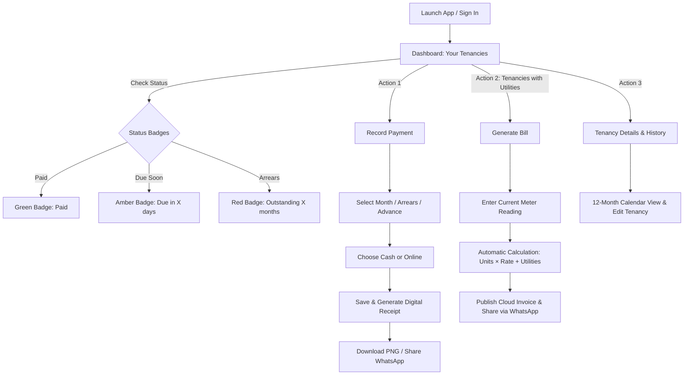

# Rental Buddy

<p align="center">
  
</p>

<h3 align="center">High-Clarity Property Ledger & Utility Splitting Tool</h3>

<p align="center">
  A mobile-first, installable Progressive Web App (PWA) designed for landlords, property owners, co-managers, and tenants to track tenancies, record rent payments, automate utility bill calculations, and issue verifiable digital payment receipts with automated clarity.
</p>

<p align="center">
  
  
  
  
  
</p>

---

## 📌 Table of Contents
- [The Problem It Solves](#-the-problem-it-solves)
- [Key Features](#-key-features)
- [Application Flow & How It Works](#-application-flow--how-it-works)
- [Tech Stack & Architecture](#-tech-stack--architecture)
- [Project Directory Structure](#-project-directory-structure)
- [Getting Started](#-getting-started)
- [Security & Access Roles](#-security--access-roles)
- [Data Ownership & Backup (.rhb)](#-data-ownership--backup-rhb)
- [Contributing & Bug Reports](#-contributing--bug-reports)
- [Author & Credits](#-author--credits)

---

## 💡 The Problem It Solves

Managing rented properties using physical notebooks or generic spreadsheet templates often creates confusion, disputes, and lost records:

1. **Complex Utility Bill Splitting**: Electricity sub-meter reading calculations (`(current - previous) × rate`) combined with water, waste management, and internet fees are prone to manual math errors.
2. **Lack of Month-Wise Settlement Clarity**: Traditional cash-in/cash-out ledgers show isolated lump sums without clarifying which specific billing cycles were settled, partially paid, or remain overdue.
3. **Broken Historical Invoices on Rent Changes**: In naive systems, updating a tenant's monthly rent retroactively changes past receipts, corrupting financial history.
4. **Disputes Over Payment Proof**: Handwritten receipts or informal messages get lost. Tenants and landlords lack clean, branded digital receipts with transaction references.
5. **Multi-User Collaboration Friction**: Property owners often need family members or property managers to check dues or record payments without granting full administrative ownership.

**Rental Buddy solves these problems** by providing an automated, cloud-synced, mobile-responsive ledger with dynamic status badges, non-destructive future rent revisions, one-tap WhatsApp summaries, and downloadable digital voucher receipts.

---

## 🚀 Key Features

### 🏠 Intelligent Multi-Tenancy Management
- **Step-by-Step Onboarding**: Guided wizard to configure property name, tenant details, 10-digit verified phone number, base rent, advance security deposit, and billing recurrence dates.
- **Configurable Utilities**: Toggle electricity (per-unit meter reading or flat rate) and water (flat or per-unit) independently per tenancy.
- **Dynamic Color-Coded Status Badges**:
  - 🔴 **Overdue / Outstanding** (`#FEE2E2` / `#DC2626`): Warns of unpaid past months, partial balances (e.g. `Outstanding • ₹500 due`), or arrears (`Outstanding 2 months`).
  - 🟡 **Due Today / Due Soon** (`#FEF3C7` / `#B45309`): Highlights payments due today or within 1–3 days (`Due in 3 days`, `Due tomorrow`).
  - 🔵 **Upcoming Cycle** (`#E0F2FE` / `#0284C7`): Indicates upcoming cycles scheduled for future dates (`Due in 12 days`).
  - 🟢 **Paid / All Settled** (`#DCFCE7` / `#16A34A`): Confirms complete settlement for the current cycle or advance payments (`Paid in Advance`).

### ⚡ Automated Utility Bill Generator
- **Automatic Meter Reading Differences**: Computes exact units consumed between billing cycles, applies the agreed unit rate, adds flat utility fees, and factors in previous credits or advance balances.
- **WhatsApp Ready Invoices**: Formats clean, professional invoice summaries ready to dispatch directly to tenants with one click.
- **Invoice Detail View**: Detailed breakdown showing base rent, meter units, flat fees, sub-totals, and final net payable amount.

### 💰 Dedicated Payment Settlement & Ledger
- **Smart Month Allocation**: Intelligently handles multi-month overdue clearances, partial payments, and advance collections without breaking historical records.
- **Split Payment Modes**: Supports Cash, Online (GPay / UPI, Bank / NEFT, Other Wallets) with optional transaction reference (UTR) numbers.
- **Quick Amount Shortcuts**: Instant buttons for `Full Due`, `Base Rent`, or rounded payment values.
- **Digital Ticket Receipt (Voucher)**: Visual ticket-style receipt with tear-off styling, downloadable instantly as a PNG image via `html2canvas` for permanent record-keeping.

### 📈 Non-Destructive Future Rent Revisions
- Landlords can schedule rent adjustments for future cycles (e.g., next month or custom date) with an optional reason/note. Historical invoices and receipts remain 100% intact.

### 👥 Family Sharing & Role-Based Access Control
- Invite co-owners or family members by email via Supabase.
- Grant **Manager** (can generate bills and record payments) or **Viewer** (read-only monitoring) access.
- Seamlessly switch roles or revoke permissions at any time.

### 🔒 Privacy & Offline-First Backup Engine (.rhb)
- Full-stack backup exporter and importer: packages properties, utility setups, historical invoices, ledger payments, and user preferences into a portable `.rhb` (Rental Buddy Backup) file.
- Relational foreign-key remapping ensures that restored files maintain database integrity on cloud databases.

---

## 🔄 Application Flow & How It Works



---

## 🛠️ Tech Stack & Architecture

| Layer | Technologies Used | Description |
|---|---|---|
| **Frontend Core** | Vanilla JavaScript (ES2022+), Semantic HTML5 | Zero bulky frameworks; ultra-fast bundle size, native DOM speed. |
| **Styling & Design** | Vanilla CSS3 (Custom Design System Tokens) | Dark slate navy (`#0E1326`), vibrant indigo (`#5452EC`), pill geometry (`9999px`), responsive down to 360px viewport. |
| **Bundler & Tooling** | [Vite 6](https://vitejs.dev/) | Lightning-fast Hot Module Replacement (HMR) and optimized rollup production build. |
| **Database & Auth** | [Supabase](https://supabase.com/) (`@supabase/supabase-js`) | PostgreSQL with Row Level Security (RLS), real-time updates, and user session management. |
| **Image Rendering** | [html2canvas](https://html2canvas.hertzen.com/) | Client-side DOM-to-canvas rendering for instant PNG digital receipt voucher downloads. |
| **PWA & Mobile** | Web App Manifest, Safe-area Insets | Installable as a native-like PWA on Android, iOS, Windows, and macOS. |

---

## 📂 Project Directory Structure

```text
Rental-buddy/
├── index.html              # Single-page application markup with all modal sheets & screens
├── package.json            # Project dependencies and build scripts
├── vite.config.js          # Vite configuration
├── AGENTS.md               # Design tokens, architectural guidelines, and engineering log
├── public/                 # Static assets, icons, and favicon
└── src/
    ├── main.js             # Core application controllers, state, UI event listeners & calculations
    ├── supabase.js         # Supabase client, cloud queries, authentication, and family sharing APIs
    └── style.css           # Design tokens, screen styles, status badges, and responsive layouts
```

---

## 💻 Getting Started

### Prerequisites
- [Node.js](https://nodejs.org/) (version 18 or later recommended)
- `npm` or `pnpm` / `yarn`

### Installation & Local Run

1. **Clone the repository**:
   ```bash
   git clone https://github.com/DoctorKishor/Rental-buddy.git
   cd Rental-buddy
   ```

2. **Install dependencies**:
   ```bash
   npm install
   ```

3. **Start the local development server**:
   ```bash
   npm run dev
   ```
   Open your browser and navigate to `http://localhost:5173`.

4. **Build for production**:
   ```bash
   npm run build
   ```
   To preview the production build locally:
   ```bash
   npm run preview
   ```

---

## 🔐 Security & Access Roles

Rental Buddy utilizes Supabase PostgreSQL Row Level Security (RLS) policies to keep property records strictly private and secure:

- **Owner**: Full administrative rights to create, revise rent, archive, or delete tenancies, generate invoices, record payments, and manage sharing permissions.
- **Manager**: Family member or property manager granted permission to generate bills, record tenant payments, and share receipts (cannot delete or reassign properties).
- **Viewer**: Read-only access to monitor payment status, view generated invoices, and inspect payment receipts.

---

## 💾 Data Ownership & Backup (.rhb)

Rental Buddy believes in **100% user data ownership**:
- Navigate to **Settings > Backup & Restore**.
- **Create Backup**: Exports an authoritative snapshot of all properties, utility configurations, historical billing invoices, payment records, and user preferences into an encrypted `.rhb` JSON file.
- **Restore**: Parses any `.rhb` file and intelligently remaps relational foreign keys, restoring historical records without creating duplicate ledger entries.

---

## 🤝 Contributing & Bug Reports

Contributions and feedback are welcome!
- **Report a Bug**: [Open an issue on GitHub](https://github.com/DoctorKishor/Rental-buddy/issues/new)
- **Request a Feature**: [Submit a Feature Request](https://github.com/DoctorKishor/Rental-buddy/issues/new?template=feature_request.md&title=%5BFeature%5D+)

---

## 👨‍💻 Author & Credits

- **Developer & Maintainer**: [Dr. Kishor](https://github.com/DoctorKishor) (`@DoctorKishor`)
- **Repository**: [https://github.com/DoctorKishor/Rental-buddy](https://github.com/DoctorKishor/Rental-buddy)
- **License**: MIT License